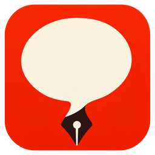
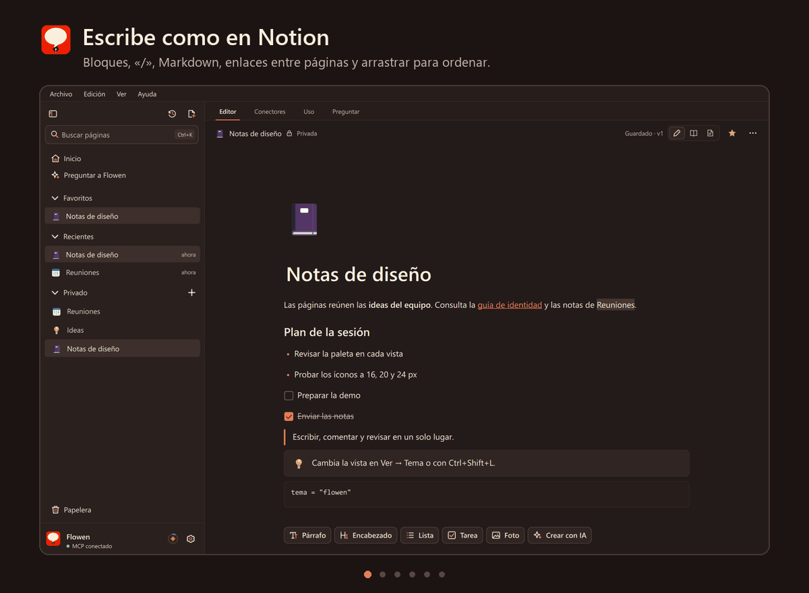
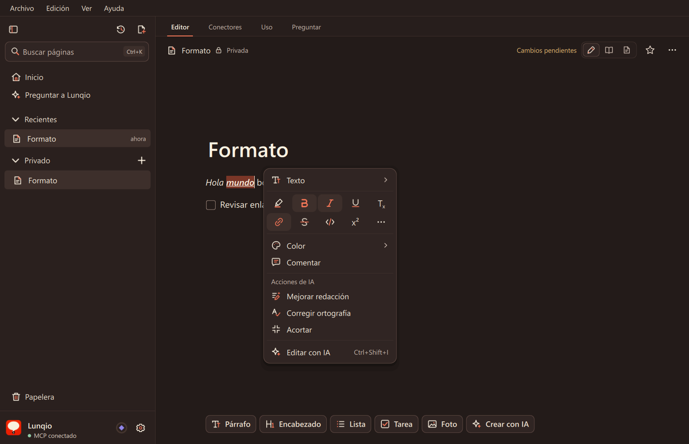
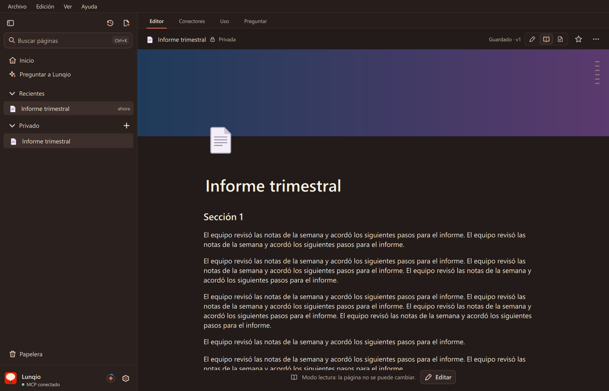
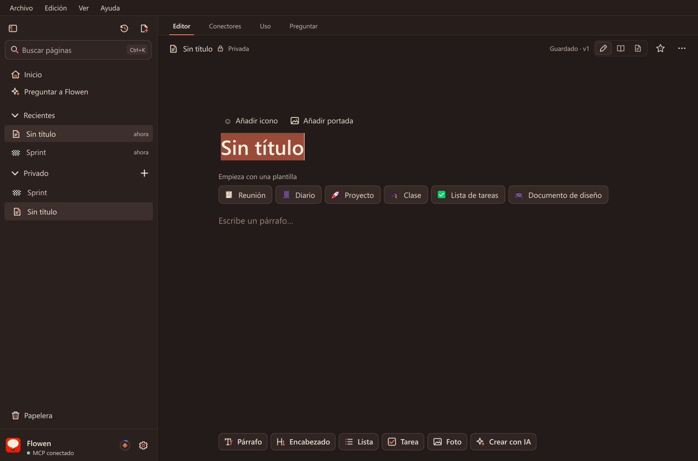
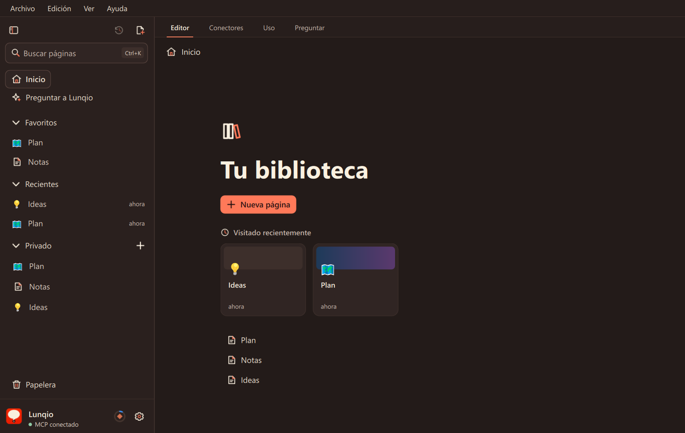
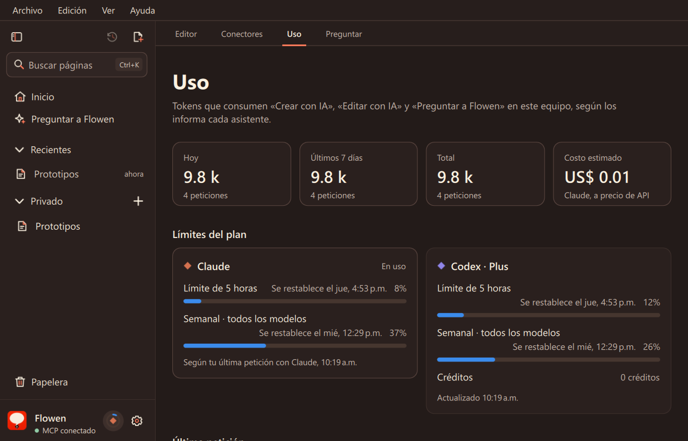
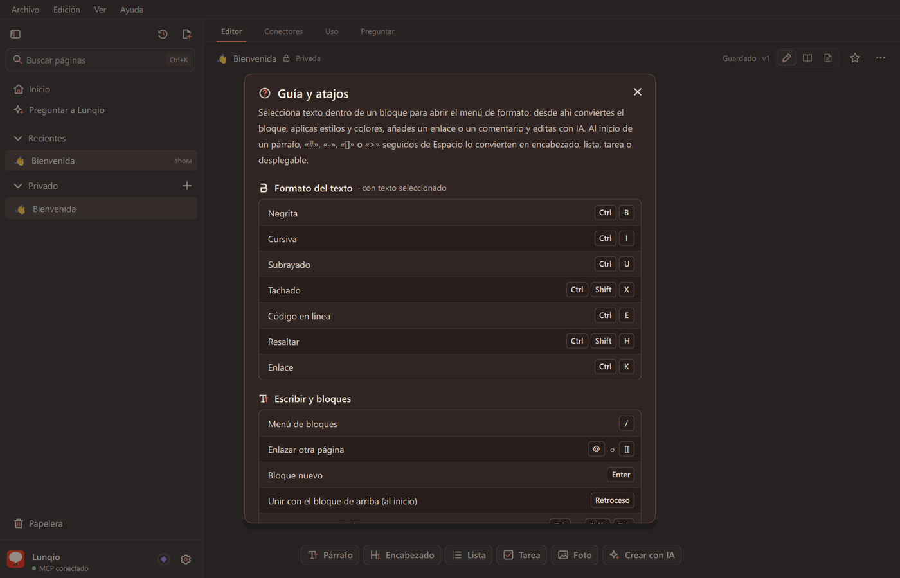
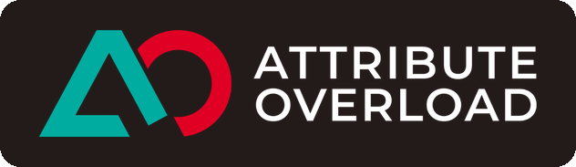

  

<h1 align="center">Flowen</h1>

  <b>Notas, páginas y tareas para Windows, guardadas en tu equipo y con IA cuando la pides.</b> 
  Escribe como en Notion, maqueta como en Word y deja que Claude o Codex trabajen sobre tus notas.

  

  <a href="docs/GUIA.md">Guía de uso</a> &nbsp;·&nbsp;
  <a href="https://robertocharretonkaplun.github.io/Flowen/">Documentación</a> &nbsp;·&nbsp;
  <a href="docs/DESARROLLO.md">Compilar</a> &nbsp;·&nbsp;
  <a href="https://www.attributeoverload.com">Attribute Overload</a>

  

## Por qué Flowen

<table>
  <tr>
    <td width="33%" valign="top"><b>Escribe sin fricción</b> Bloques, «/» para insertar, Markdown al escribir, enlaces entre páginas, plantillas y arrastrar para ordenar.</td>
    <td width="33%" valign="top"><b>Maqueta como en Word</b> Diseño de página con hojas Carta o A4, márgenes y un PDF del mismo tamaño. Modo lectura para revisar sin cambiar nada.</td>
    <td width="33%" valign="top"><b>IA cuando la pides</b> Crea bloques, mejora un párrafo o pregunta sobre tus notas con Claude o Codex. Nada entra en la página sin tu visto bueno.</td>
  </tr>
  <tr>
    <td valign="top"><b>Tus notas son tuyas</b> Una biblioteca local con historial de revisiones, papelera y copias de seguridad. Funciona sin conexión.</td>
    <td valign="top"><b>Conecta tu asistente</b> Servidor MCP incluido para Claude Desktop, Claude Code y Codex, que se activa con un interruptor.</td>
    <td valign="top"><b>Ordena y revisa</b> Comentarios con respuestas, favoritos, recientes, búsqueda sin acentos y cuatro temas claros y oscuros.</td>
  </tr>
</table>

## Empieza en un minuto

1. Descarga el instalador **Flowen-…-Setup-x64.exe** de la [última versión](https://github.com/robertocharretonkaplun/Flowen/releases/latest).
2. Ábrelo y sigue el asistente. No pide permisos de administrador: se instala para tu usuario, con un acceso en el menú Inicio.
3. Abre **Flowen** desde el menú Inicio.

El instalador aún no tiene firma digital, así que Windows puede mostrar «Windows protegió tu PC». Pulsa **Más información → Ejecutar de todas formas**. Si prefieres no instalar nada, en la misma versión está **Flowen-x64.zip**: descomprímelo en una carpeta permanente y abre `flowen.exe`.

**Requisitos:** Windows 10 u 11 de 64 bits. Las funciones de IA son opcionales y usan Claude Code o Codex instalados con tu cuenta.

**¿Venías usando Lunqio?** Flowen es su nuevo nombre. La primera vez que lo abras, tus notas, preferencias y conectores pasan solos a Flowen, y la copia anterior queda intacta. Detalles en la [guía](docs/GUIA.md#si-vienes-de-lunqio).

| Para | Haz esto |
| --- | --- |
| Crear una página | **Ctrl+N** |
| Insertar un bloque | Escribe **/** |
| Dar formato o comentar | Selecciona el texto |
| Escribir con IA | **Ctrl+J**, o **Espacio** en un párrafo vacío |
| Preguntar sobre tus notas | **Ctrl+Shift+P** |
| Cambiar entre Edición, Lectura y Diseño de página | **Ctrl+Shift+E**, **R** o **D** |
| Ver todos los atajos | **F1** |

## Conecta Claude o Codex

Abre la pestaña **Conectores** (**Ctrl+,**) y activa **Claude Desktop**, **Claude Code** o **Codex**. Flowen registra su servidor MCP en ese cliente y, desde entonces, puedes pedirle a tu asistente cosas como «Crea la página Acuerdos dentro de Reuniones, con una tarea para enviar la minuta». Los cambios aparecen en Flowen con su revisión, y se pueden deshacer desde el historial. Todos los detalles están en la [guía](docs/GUIA.md#conectores-claude-y-codex).

## Privacidad

Tus notas viven en `%LOCALAPPDATA%\Flowen\notas.sqlite3`. Flowen no se conecta a internet por su cuenta: cuando usas una función de IA, Claude Code o Codex reciben solo lo que esa función necesita (la selección, la página o los fragmentos relacionados con tu pregunta). Un asistente que conectes por MCP puede leer y editar tu biblioteca cuando se lo pidas, y cada cambio queda en el historial.

<b>Más capturas</b>

 
<table>
  <tr>
    <td width="50%"> <b>Formato</b>: estilo, color, enlace o comentario sobre la selección.</td>
    <td width="50%"> <b>Modo lectura</b>: la página sin herramientas.</td>
  </tr>
  <tr>
    <td> <b>Plantillas</b>: empieza una página con un clic, o guarda las tuyas.</td>
    <td> <b>Inicio</b>: tus páginas recientes y favoritas.</td>
  </tr>
  <tr>
    <td> <b>Uso</b>: tokens, costo estimado y límites de cada asistente.</td>
    <td> <b>Guía y atajos</b>: todos los atajos, por tema (F1).</td>
  </tr>
</table>

## Documentación

| | |
| --- | --- |
| [Guía de uso](docs/GUIA.md) | Todo lo que hace Flowen, sección por sección. |
| [Documentación del código](https://robertocharretonkaplun.github.io/Flowen/) | Las clases y funciones, generadas con Doxygen y publicadas en GitHub Pages. |
| [Arquitectura](docs/ARQUITECTURA.md) | Cómo está organizado el código y las reglas para ampliarlo. |
| [Desarrollo](docs/DESARROLLO.md) | Compilar con Qt 6.8 y CMake, probar, empaquetar y el contrato MCP. |

## Créditos

Flowen es una aplicación creada por **[Attribute Overload](https://www.attributeoverload.com)**. En la aplicación, **Ayuda → Acerca de Flowen** muestra la versión y enlaza al sitio, al código y a la documentación.
