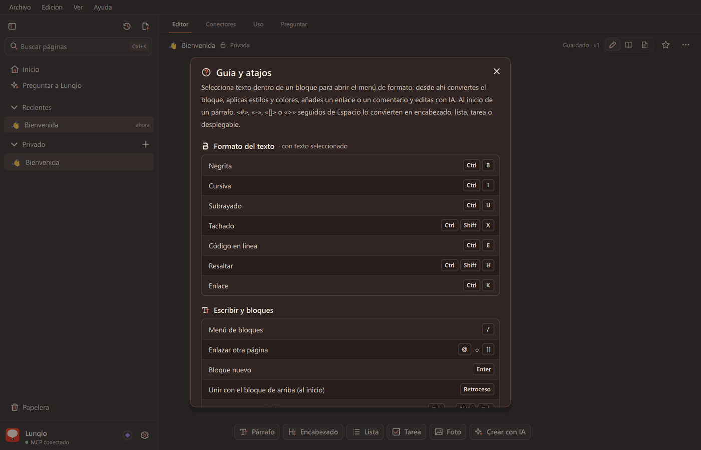
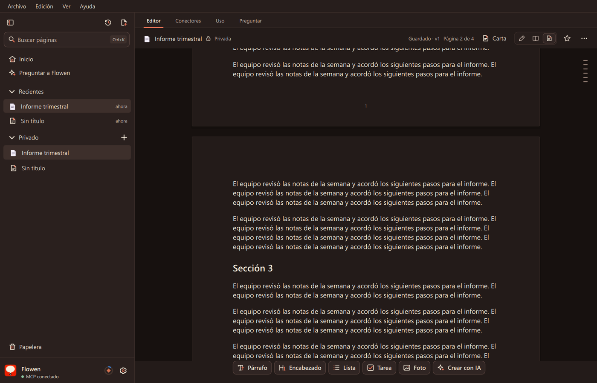
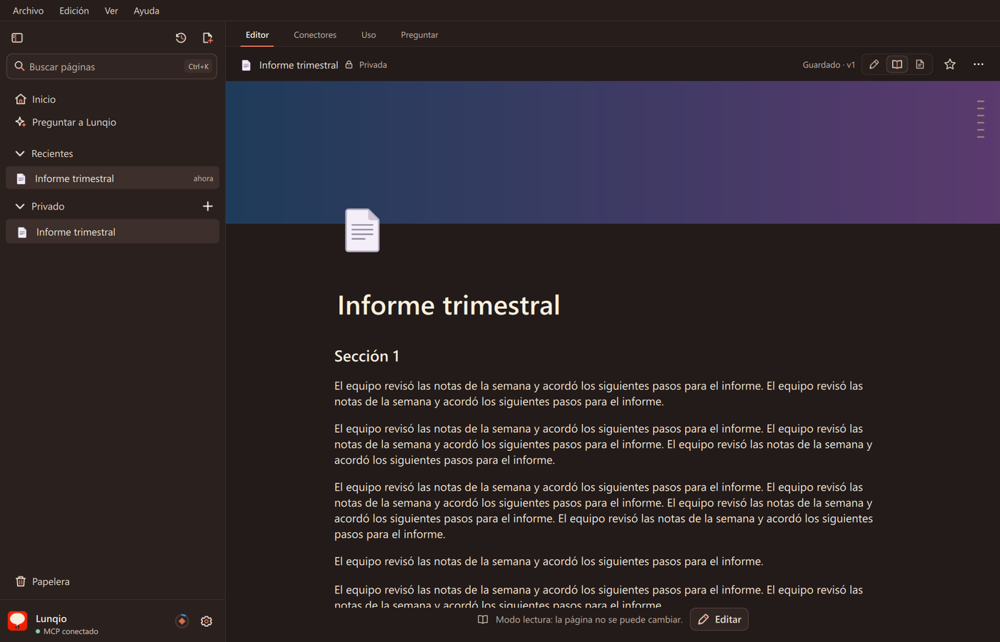
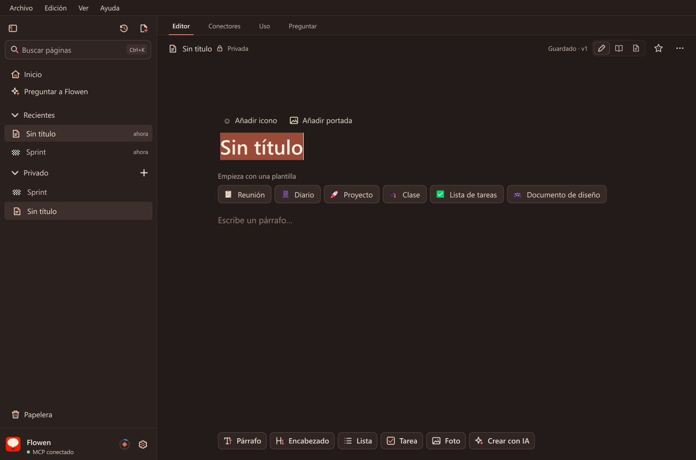
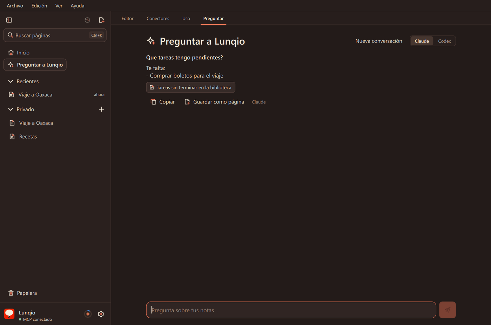
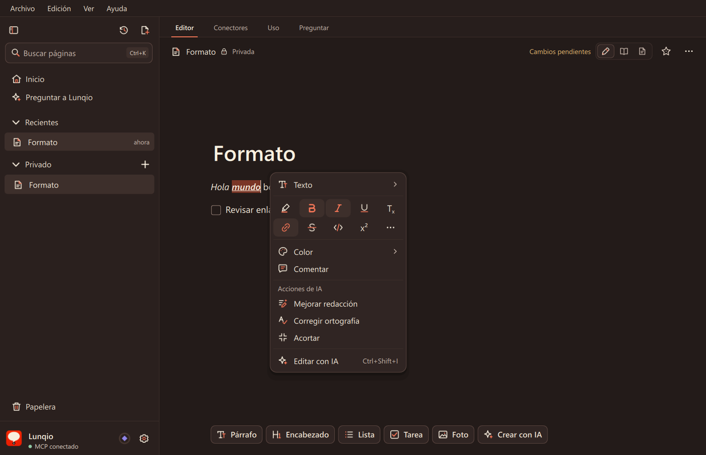
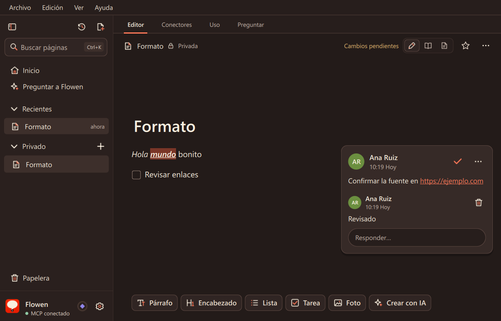
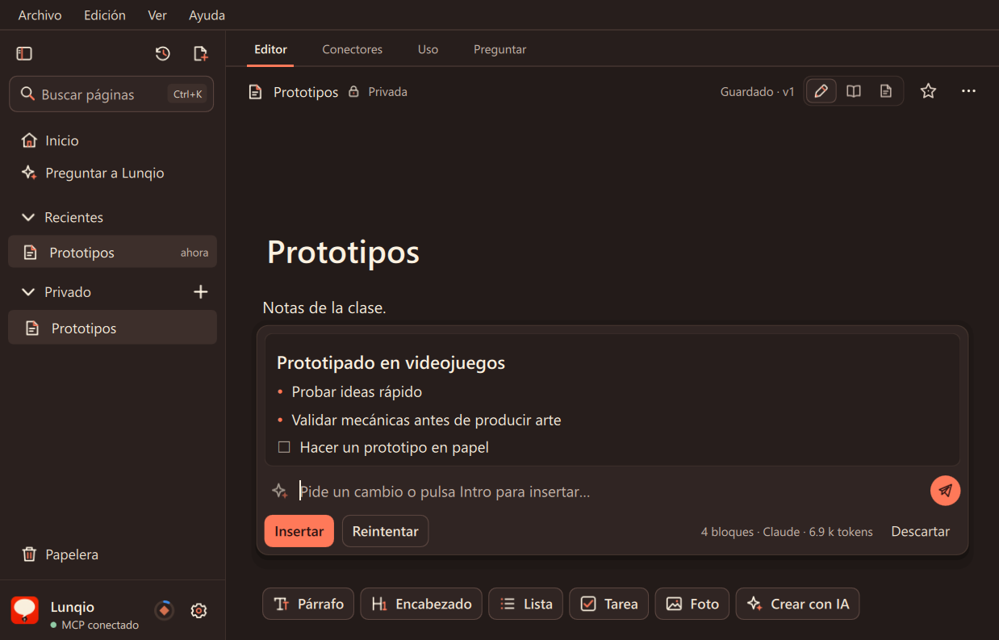
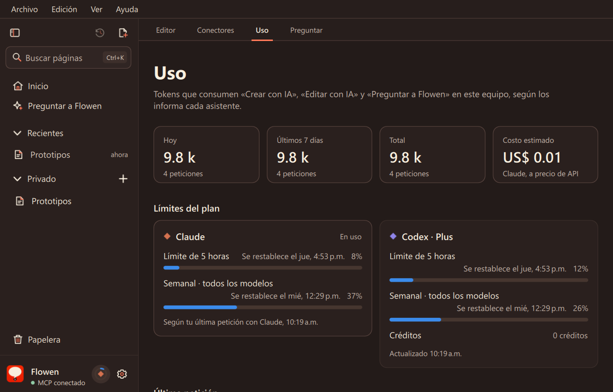
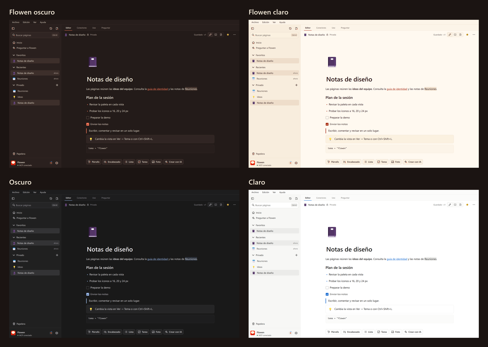

# Guía de uso de Flowen

Todo lo que hace Flowen, sección por sección. Para empezar rápido, mira el [README](../README.md); para compilarlo o ampliarlo, [Desarrollo](DESARROLLO.md) y [Arquitectura](ARQUITECTURA.md). Dentro de la aplicación, **F1** abre la guía de atajos.

## Abrir la aplicación

1. Instala Flowen con **Flowen-…-Setup-x64.exe** (se instala para tu usuario, sin permisos de administrador) o descomprime **Flowen-x64.zip** en una carpeta permanente.
2. Abre **Flowen** desde el menú Inicio (o `flowen.exe`). Pulsa **Nueva página**, escribe el título y edita el primer párrafo. Usa los controles al pie de la página para añadir encabezados, párrafos, elementos de lista o tareas.
3. El indicador **Guardado** muestra la revisión actual. **Opciones de página** permite crear subpáginas, mover la página, consultar el historial, guardar una copia en distintos formatos o enviar la página y sus descendientes a la papelera. El menú de cada bloque permite reordenarlo o eliminarlo.



**Ctrl+N** crea una página, **Ctrl+K** activa la búsqueda y **Ctrl+S** guarda la edición. **F1** abre **Ayuda → Guía y atajos**, con todos los atajos en tablas por tema. El guardado automático agrupa las pulsaciones tras una pausa de 750 ms. El editor comprueba los cambios externos al recuperar el foco y cada segundo mientras está activo. Si tu borrador entra en conflicto, puedes exportarlo a Markdown antes de descartar los cambios y recargar.

## Barra lateral, archivos y fotos

La barra lateral reúne la búsqueda, Inicio, las páginas privadas y la papelera. La búsqueda no distingue mayúsculas ni acentos («arbol» encuentra «Árbol»). Primero muestra la página que se llama así, luego las que empiezan o contienen el texto en el título, y después las que lo mencionan; dentro de cada grupo, las editadas más recientemente. El lápiz de arriba crea una página. Al pasar sobre una página, el botón **+** crea una subpágina. Puedes plegar **Privado**, ocultar la barra o arrastrar su borde derecho para cambiar el ancho. Un doble clic en el borde recupera el ancho automático. El estado de MCP aparece junto al espacio de trabajo, en la parte inferior.

Con **clic derecho** sobre cualquier página de la barra lateral (también en Favoritos y Recientes) puedes **Abrir**, **Añadir a favoritos**, crear una **Nueva subpágina**, **Duplicar**, **Cambiar nombre…**, **Mover a…** o **Enviar a la papelera**. La página va a la papelera al momento (con sus subpáginas) y abajo aparece un aviso con **Deshacer** durante unos segundos. Lo mismo ocurre con **⋯ → Enviar a la papelera**. En la papelera, el clic derecho ofrece **Restaurar**. **Duplicar** copia el aspecto y los bloques de la página, pero no sus comentarios ni sus subpáginas. **Mover a…** no ofrece la propia página ni las que están dentro de ella.

### Vistas: Edición, Lectura y Diseño de página

Los tres botones de la barra superior, junto a la estrella, cambian cómo se muestra la página, como los botones de vista de Word. También están en **Ver**. Flowen recuerda la vista, el papel y los márgenes para la próxima vez.

| Vista | Atajo | Qué hace |
| --- | --- | --- |
| Edición | Ctrl+Shift+E | El editor de siempre. |
| Modo lectura | Ctrl+Shift+R | La página no se puede cambiar: el texto se puede seleccionar y copiar, pero no se escribe, no se arrastran bloques ni se pegan fotos. Se ocultan las herramientas de abajo, las plantillas y los comentarios. Los enlaces web se abren con un clic. Abajo, **Editar** vuelve a Edición. Crear una página nueva también vuelve a Edición. |
| Diseño de página | Ctrl+Shift+D | La página sobre hojas de papel, como en Word: márgenes, número en cada hoja y **Página 2 de 5** en la barra superior. Se sigue escribiendo igual. Un bloque que no cabe en lo que queda de la hoja pasa a la siguiente, y un encabezado se queda con el bloque que le sigue. La portada no aparece, como en una hoja impresa. Los comentarios van al margen derecho de la hoja. |

En Diseño de página, el botón **Carta** (o **A4**) elige el papel y los márgenes, y ofrece **Guardar como PDF…**. El PDF sale con ese mismo papel y esos márgenes. Mientras no elijas un papel, Flowen usa Carta en los países de América que lo usan (México, Estados Unidos, Colombia, Chile y otros) y A4 en el resto.

| Papel o márgenes | Medida |
| --- | --- |
| Carta | 21,6 × 27,9 cm |
| A4 | 21 × 29,7 cm |
| Márgenes normales | 2,54 cm |
| Márgenes estrechos | 1,27 cm |
| Márgenes anchos | 2,54 cm arriba y abajo, 5,08 cm a los lados |

Flowen no corta un párrafo entre dos hojas: si un bloque es más alto que una hoja entera, se queda donde está y puede pasar al margen.





### Navegar por la página

- Arriba, junto al título, se ven las **páginas superiores** (hasta tres). Un clic abre cualquiera.
- Si la página tiene al menos dos encabezados, en su borde derecho aparece un **índice**: una línea corta por encabezado. Al pasar el puntero muestra los títulos, y un clic lleva a ese punto. Si hay comentarios a la derecha, el índice pasa al borde izquierdo.

**Archivo → Guardar como…** (**Ctrl+Shift+S**) guarda una copia de la página en la carpeta que elijas. **Ctrl+S** guarda los cambios en la biblioteca local.

| Formato | Fotos |
| --- | --- |
| PDF | Incluye las imágenes con su proporción y ancho de impresión. Usa el papel y los márgenes de Diseño de página. |
| HTML | Incluye las imágenes en el mismo archivo. |
| Markdown | Guarda los archivos de imagen en una carpeta `.media` junto al documento. Para compartirlo con fotos, incluye esa carpeta. |
| Texto plano | Usa el pie de foto para identificar cada imagen. |

### Favoritos y recientes

La estrella junto a **Opciones de página** añade la página abierta a **Favoritos**, arriba en la barra lateral. Pulsa la estrella otra vez para quitarla. También puedes hacerlo con **Opciones de página** o con clic derecho sobre cualquier página de la barra. Arrastra un favorito para cambiar su orden. Al pasar el ratón sobre un favorito, su estrella lo quita.

**Recientes** muestra las cinco últimas páginas que abriste, con el tiempo transcurrido. En **Inicio**, **Visitado recientemente** muestra hasta ocho como tarjetas con su portada e icono. Las páginas en la papelera desaparecen de ambas listas. Si las restauras, vuelven a Favoritos en el mismo lugar.

Favoritos y recientes se guardan en la biblioteca, así que también viajan en las copias de seguridad. Marcar un favorito o abrir una página no crea revisiones, y MCP no ve estas listas. Buscar o abrir la papelera las oculta mientras tanto.

Pulsa **Foto** al pie del editor, escribe **/foto** o usa **Edición → Insertar foto…** para elegir uno o varios PNG o JPEG locales de hasta 32 MiB y 40 megapíxeles. Las fotos aparecen debajo del bloque donde escribes, o lo sustituyen si es un párrafo vacío; sin ningún bloque en uso, van al final. También puedes arrastrar archivos desde el Explorador: una línea marca dónde quedarán. Arrastra la esquina inferior derecha o usa **Ancho** para ajustar la foto entre el 10 % y el 100 % de la columna.

El menú **⋮⋮** de una foto permite:

- **Alinear** la foto a la izquierda (lo predeterminado), al centro o a la derecha.
- Elegir un **Estilo**: normal, esquinas redondeadas, con borde o con sombra.
- Fijar el **Ancho** en 25 %, 50 %, 75 % o la columna completa.
- **Ver a tamaño completo** (también con doble clic), **Reemplazar foto…**, **Guardar foto como…** (PNG o JPEG) y **Copiar imagen**.
- Subir, bajar o eliminar la foto.

El pie de foto sigue la alineación. Alineación y estilo se guardan con la página y se exportan a HTML y PDF. La biblioteca guarda la imagen, su pie y el ancho. Seguirá disponible si mueves el original. Las copias de seguridad incluyen las fotos.

También puedes pegar una imagen con **Ctrl+V** (o **Pegar** en el menú contextual). Sirve con una captura de pantalla, con **Copiar imagen** de un navegador o con archivos PNG y JPEG copiados en el Explorador. La foto aparece debajo del bloque donde está el cursor. Si ese bloque es un párrafo vacío, la foto lo sustituye. Los archivos conservan su nombre como pie de foto. Si copias texto de Word, Excel o una página web, se pega como texto aunque el portapapeles incluya una imagen de ese texto. Las imágenes grandes sin transparencia se guardan como JPEG, igual que al elegir un archivo.

## Escribir como en Notion

- **Intro** crea un bloque nuevo; si el cursor está en medio, el resto del texto pasa al bloque nuevo con su formato. **Mayús+Intro** salta de línea dentro del mismo bloque. En una lista o tarea, Intro continúa la lista; en un elemento vacío, la termina.
- **Retroceso** al inicio de un bloque lo une con el anterior. En un encabezado, lista o tarea, primero lo convierte en texto.
- **↑** y **↓** pasan al bloque anterior o siguiente desde la primera o la última línea.
- **/** abre el menú de bloques: texto, encabezados 1, 2 y 3, lista con viñetas, lista numerada, tarea, desplegable, cita, nota destacada, código, separador, foto o **Crear con IA**. Sigue escribiendo para filtrar («/tar», «/enc»), elige con las flechas e **Intro**, o cierra con **Esc**.
- Atajos Markdown al inicio de una línea, seguidos de un espacio: `#`, `##` y `###` encabezados, `-`, `*` o `+` lista, `1.` lista numerada, `[]` tarea, `>` desplegable, `"` cita y ```` ``` ```` código. `---` crea un separador. Dentro del texto: `**negrita**`, `*cursiva*` o `_cursiva_`, `~~tachado~~` y `` `código` `` se convierten al escribir el cierre.
- **Tab** anida el bloque bajo el anterior (como mucho un nivel más) y **Mayús+Tab** lo saca. Las viñetas cambian con el nivel (•, ◦, ▪) y las listas numeradas cuentan por nivel. Un **desplegable** oculta lo que tiene anidado debajo; pulsa su triángulo para abrirlo o cerrarlo, e **Intro** en un desplegable abierto crea su primer elemento.
- En un bloque de **código**, **Intro** añade una línea, **Tab** inserta espacios y **Ctrl+Intro** sale del bloque. En una **nota destacada**, pulsa el emoji para cambiarlo.
- Al pasar el puntero por un bloque aparecen, a su izquierda, **+** (añade una línea debajo con el menú «/» abierto) y **⋮⋮**. Arrastra ⋮⋮ para mover el bloque; una línea marca dónde quedará. Un clic en ⋮⋮ abre el menú del bloque: convertir, **Color del texto**, **Color de fondo**, **Alinear**, sangría, subir, bajar o eliminar.
- **Ctrl+D** (o **Duplicar** en el menú ⋮⋮) copia el bloque justo debajo, sin sus comentarios.
- **Ctrl+Z** deshace también lo que cambia los bloques: dividir con Intro, unir con Retroceso, añadir, mover o eliminar, cambiar el tipo, la sangría, el color o la alineación, e insertar fotos. Primero se deshace el texto que escribiste en el bloque; cuando ya no queda nada, Ctrl+Z vuelve al estado anterior de los bloques. **Ctrl+Y** lo rehace.

## Enlaces entre páginas

Escribe **@** o **[[** para mencionar otra página. Sigue escribiendo para buscarla (sin importar acentos), elige con las flechas e **Intro**, o **Nueva página «…»** para crearla como subpágina de la actual. La mención se ve como una etiqueta con el nombre de la página; un clic la abre.

Bajo el título, **«N páginas enlazan aquí»** muestra qué páginas mencionan la actual, con el fragmento donde lo hacen. Las menciones se guardan como enlaces `lunqio://page/<id>` (el nombre anterior de Flowen: así siguen valiendo los enlaces que ya tienes)` dentro del formato del texto, así que MCP también las ve. Al exportar, la mención queda como texto.

Si cambias el nombre de una página, las menciones que mostraban el nombre anterior se actualizan en todas las páginas, también cuando el cambio lo hace Claude o Codex. Cada página que cambia guarda una revisión. Si editaste el texto de una mención a mano, se conserva.

## Plantillas

Una página nueva o vacía muestra **Empieza con una plantilla** bajo el título. Flowen trae seis: **Reunión**, **Diario**, **Proyecto**, **Clase**, **Lista de tareas** y **Documento de diseño**. Las de reunión, diario y clase ponen la fecha de hoy en el título. Al elegir una, la página toma sus bloques, su icono y su aspecto, y su título si aún no tenía nombre. **Ctrl+Z** la deshace.



**⋯ → Guardar como plantilla…** guarda la página abierta como plantilla tuya, con su título, icono, portada, tipografía y bloques (sin comentarios). Aparece junto a las de Flowen con un borde de color; al pasar el puntero, **×** la elimina. Tus plantillas se guardan en la biblioteca y viajan en las copias de seguridad.

## Preguntar a Flowen

Pulsa **Preguntar a Flowen** en la barra lateral, la pestaña **Preguntar** o **Ctrl+Shift+P**, y pregunta sobre lo que tienes escrito, por ejemplo «¿Qué decidimos sobre el presupuesto?».



- Flowen elige las páginas que comparten más palabras con la pregunta (sin importar acentos) y añade la página abierta. Si preguntas por tareas o pendientes, añade también las tareas sin terminar de toda la biblioteca. Envía hasta unos 16 000 caracteres de texto.
- Claude o Codex (elígelo arriba a la derecha) responde solo con esas notas y dice cuáles usó. Pulsa una fuente para abrir la página. Si las notas no contienen la respuesta, lo dice.
- **Copiar** copia la respuesta y **Guardar como página** la convierte en una página con enlaces a sus fuentes.
- La conversación dura hasta que cierras Flowen; **Nueva conversación** la vacía. El asistente no tiene herramientas: no puede cambiar tus páginas. Los tokens aparecen en **Uso** como «Preguntar».

## Icono y portada

Pasa el puntero sobre el título y pulsa **Añadir icono** para elegir un emoji, o **Añadir portada** para poner un degradado. Al pasar el puntero por la portada, **Cambiar portada** ofrece ocho degradados o **Subir una foto…** (PNG o JPEG); **Quitar** la elimina. Pulsa el icono para cambiarlo o quitarlo. El icono aparece también en la barra lateral, en la cabecera y en el título de las exportaciones. Ambos se guardan con la página y su historial, y MCP puede cambiarlos con `update_page` (`icon` y `cover`).

## Dar formato al texto

Selecciona texto dentro de un bloque. Al soltar el ratón, o tras seleccionar con el teclado, aparece un menú junto a la selección:



- **Convertir** el bloque en texto, encabezado, lista o tarea.
- Aplicar **resaltado**, **negrita**, **cursiva**, **subrayado**, **tachado**, **código en línea** o **superíndice**. El botón se marca cuando toda la selección ya tiene ese estilo y al pulsarlo se quita. **Quitar formato** elimina los estilos y los colores, y conserva enlaces y comentarios.
- **Color**: elegir el color del texto o del fondo entre nueve (gris, marrón, naranja, amarillo, verde, azul, morado, rosa y rojo). Cada tema los dibuja en sus propios tonos para que se lean bien. **Esc** cierra la paleta.
- Añadir un **enlace** `http` o `https`. Si escribes `ejemplo.com`, Flowen añade `https://`. Ctrl+clic abre el enlace en el navegador.
- **Comentar** la selección. Ver **Comentarios** más abajo.
- Pedir a Claude o Codex que mejore, corrija o acorte la selección, o abrir **Editar con IA**.

**Esc** cierra el menú y conserva la selección. Los estilos se guardan con la página, se pueden deshacer con **Ctrl+Z**, llegan a MCP como `spans` (con `color` y `background`) y se exportan a PDF, HTML y Markdown.

### Párrafos y página

- El menú **⋮⋮** de un bloque de texto cambia el **Color del texto** o el **Color de fondo** del bloque entero y lo **Alinea** a la izquierda, al centro, a la derecha o justificado.
- El menú **⋯** de la página elige la **Fuente** (predeterminada, serif o mono), **Texto pequeño** y **Ancho completo**. Se aplican al título y a todos los bloques.
- Todo se guarda con la página y su historial, se exporta a HTML y PDF y llega a MCP: `align`, `color` y `background` en cada bloque, y `font`, `small_text` y `full_width` en la página.

| Atajo | Estilo |
| --- | --- |
| Ctrl+B | Negrita |
| Ctrl+I | Cursiva |
| Ctrl+U | Subrayado |
| Ctrl+Shift+X | Tachado |
| Ctrl+E | Código en línea |
| Ctrl+Shift+H | Resaltar |
| Ctrl+K | Enlace (con texto seleccionado; sin selección abre la búsqueda) |

## Comentarios

Selecciona texto y pulsa **Comentar** en el menú de selección. A la derecha del texto aparece una tarjeta: escribe el comentario y pulsa **Intro** o **Comentar** (**Mayús+Intro** añade una línea).



- Cada tarjeta muestra tu nombre, la hora («10:31 Hoy»), el texto con los enlaces activos y sus respuestas. Escribe en **Responder…** para contestar.
- **✓** marca el comentario como resuelto: se oculta y el texto deja de estar sombreado. Arriba aparece «N comentarios resueltos · Mostrar» para verlos o **Reabrir** uno.
- **⋯** permite editar o eliminar el comentario y **Cambiar mi nombre…**. Por defecto se usa el nombre completo de tu cuenta de Windows.
- Al colocar el cursor en un texto comentado se abre su tarjeta. Las tarjetas se alinean con su texto; la columna de la página se estrecha para dejarles sitio. Si la ventana es estrecha, solo flota la tarjeta abierta.
- Los comentarios se guardan con la página, se pueden deshacer con **Ctrl+Z** y llegan a MCP dentro de cada `span` (`comment` y `thread` con autor, hora, estado y respuestas), así que Claude o Codex también pueden leerlos y responderlos.

## Crear con IA

Pulsa **Espacio** en una línea vacía, **Ctrl+J** o **✦ Crear con IA** al pie de la página. Aparece un cuadro para pedir lo que quieras, por ejemplo «Crea una serie de puntos sobre qué es el prototipado en videojuegos».



- Con el cuadro vacío verás sugerencias: continuar escribiendo, resumir lo anterior, lista de puntos, lluvia de ideas, esquema, lista de tareas o explicar. Usa las flechas e **Intro** para elegir.
- La IA escribe bloques reales y te los muestra antes de tocar la página: encabezados de tres tamaños, párrafos, listas con viñetas y numeradas, tareas, citas, notas destacadas, código, desplegables y separadores. Recibe el título y el texto cercano para continuar con coherencia.
- **Intro** o **Insertar** los añade. Si abriste el cuadro en una línea vacía, la reemplaza; si no, los pone debajo. Escribe otra indicación para ajustar el resultado, o usa **Reintentar** o **Descartar**. **Esc** detiene o cierra.

## Elegir Claude o Codex

**Crear con IA** y **Editar con IA** pueden escribir con **Claude** o con **Codex**. Cambia entre ellos en el propio cuadro, en el diálogo o en **Conectores → IA dentro de Flowen**. Si uno alcanza su límite de uso, el aviso ofrece **Usar** el otro.

Claude usa Claude Code, el que trae la app de Claude o uno instalado aparte. Esa copia necesita su propio inicio de sesión una vez: pulsa **Iniciar sesión**, entra con tu cuenta de Claude en la ventana que se abre y vuelve a Flowen. Codex usa tu sesión de Codex.

## Uso

La pestaña **Uso**, junto a **Conectores**, muestra los tokens que consumen **Crear con IA** y **Editar con IA**, según los informa cada asistente:



- Tokens de hoy, de los últimos 7 días y en total, con el número de peticiones, y el costo estimado. Solo Claude informa el costo, calculado a precio de API; con una suscripción no se cobra aparte.
- **Última petición**: un anillo con el porcentaje de la ventana de contexto que ocupó y su desglose en entrada, caché leída, caché escrita y salida.
- Una gráfica de los últimos 14 días por asistente (pasa el puntero sobre un día para ver las cifras) y la lista de peticiones recientes.

Cada propuesta indica también sus tokens. El historial se guarda solo en este equipo, en `%LOCALAPPDATA%\Flowen\usage.jsonl`; **Borrar historial** lo elimina.

### Límites del plan

Junto al engrane de la barra lateral hay un indicador de uso: un anillo azul con el porcentaje usado del límite de 5 horas y, en el centro, un rombo con el color del asistente activo (naranja para Claude, violeta para Codex). Al pasar el puntero se ven el límite de 5 horas y el semanal, cuándo se restablecen y, en Codex, los créditos; un clic, o **Ver todo**, abre la pestaña **Uso**, que muestra los límites de ambos asistentes.

Estos límites son los de tu plan y cuentan también lo que usas fuera de Flowen. Codex los informa en cualquier momento mediante `codex app-server`. Claude Code los informa junto con cada petición, así que Flowen muestra los de tu última petición con Claude.

## Editar un fragmento con IA

1. Selecciona una frase dentro de un bloque. Pulsa **Editar con IA** en el menú junto a la selección o usa **Ctrl+Shift+I**. La misma acción está en **Edit** y en el menú del botón derecho. Las acciones rápidas del menú generan la propuesta directamente.
2. Elige **Mejorar redacción**, **Corregir** o **Acortar**, o escribe tu instrucción. **Generar propuesta** envía la selección y la instrucción a Claude o Codex, según el que elijas arriba a la derecha.
3. Compara el original con la propuesta. **Aplicar** reemplaza esa aparición del fragmento y crea una revisión. **Cancelar** conserva el texto original. Si la página cambió mientras revisabas la propuesta, vuelve a seleccionar el fragmento en la revisión actual.

El indicador **MCP conectado** corresponde a la conexión entre esta ventana y el ejecutable local `notas-mcp` de la biblioteca abierta. Aparece después de negociar el protocolo y verificar las herramientas. Pulsa el indicador o la pestaña **Conectores** para revisarla. La escritura con IA requiere Claude Code o Codex con una sesión iniciada, acceso al servicio y la conexión del editor activa. El editor manual funciona también con MCP desconectado.

**Archivo** reúne las acciones de archivo y copia de seguridad. **Edición** incluye los comandos de texto. **Ver** controla la barra lateral, la búsqueda, el historial, la papelera y el tema. **Ayuda** ofrece los atajos y la información de la aplicación.

## Conectores: Claude y Codex

1. Abre Flowen desde su carpeta permanente. Selecciona la pestaña **Conectores**, junto a **Editor**, o pulsa **Ctrl+,**.
2. En **Clientes**, activa el interruptor de **Claude Desktop**, **Claude Code** o **Codex**. Flowen registra el servidor `notas-mcp` y la biblioteca abierta en la configuración de ese cliente. Desactívalo para dejar de compartir la biblioteca con él.
3. Abre un chat nuevo en el cliente y pide, por ejemplo, «Crea una subpágina llamada Acuerdos en la página Reuniones y añade una tarea para enviar la minuta». Puedes volver a **Editor** para ver el resultado.

| Cliente | Dónde se guarda | Al desactivar |
| --- | --- | --- |
| Claude Desktop | `claude_desktop_config.json`. Flowen guarda antes una copia `.flowen-backup` junto al archivo. | Quita la entrada. Reinicia Claude Desktop para aplicar el cambio. |
| Claude Code | Ámbito de usuario (`~/.claude.json`) mediante `claude mcp add`. Sirve en todos tus proyectos. | Ejecuta `claude mcp remove`. |
| Codex | `~/.codex/config.toml` mediante `codex mcp add`. | Marca la entrada con `enabled = false`, igual que el interruptor de Codex. **Quitar registro** la elimina. |

Flowen busca `claude.exe` en el PATH, en `~\.local\bin` y dentro de la app de Claude, y `codex.exe` en el PATH y en la app de Codex. Si no los encuentra, el menú **⋯** de cada cliente permite elegir el ejecutable, comprobar el estado o mostrar el archivo de configuración. La primera biblioteca usa el nombre `flowen`. Otra biblioteca recibe un nombre propio. Si mueves el paquete, el cliente muestra **Ruta antigua**; actívalo de nuevo para actualizar la ruta.

En **Servidor de la biblioteca** puedes conectar o desconectar la sesión del editor que usa **Editar con IA** y elegir si se inicia con Flowen. Los clientes abren su propia sesión, aunque Flowen esté cerrado. El listado de herramientas procede de la sesión del editor. Para otros clientes compatibles con la configuración JSON `mcpServers`, pulsa **Copiar JSON** en **Otro cliente MCP**.

También puedes registrar el servidor desde PowerShell. Abre la carpeta descomprimida y mantén los archivos del paquete juntos.

```powershell
$server = (Resolve-Path .\notas-mcp.exe).Path
codex mcp add flowen -- $server
codex mcp get flowen
```

Abre una conversación nueva de Codex con el servidor habilitado. Por ejemplo, crea una página titulada **Bitácora** en Flowen y pídele a Codex «Busca Bitácora, lee sus bloques y añade una tarea que diga Revisar el borrador». La revisión deberá avanzar en el editor. En **Opciones → Historial de revisiones**, pulsa **Restaurar** junto a la versión previa para recuperar el contenido.

Para una biblioteca de prueba, utiliza la misma ruta absoluta en ambos procesos. Para acceso de solo lectura añade `--read-only` después de los argumentos del servidor y abre previamente esa biblioteca en el editor. Al mover el paquete, vuelve a registrar la ruta del ejecutable. [Configuración MCP de Codex](https://developers.openai.com/codex/mcp/)

```powershell
$db = Join-Path $env:LOCALAPPDATA 'Flowen\prueba.sqlite3'
.\flowen.exe --db $db
codex mcp add flowen-prueba -- $server --db $db
```

## Datos y recuperación

La ruta habitual es `%LOCALAPPDATA%\Flowen\notas.sqlite3`. Ambos ejecutables resuelven, por orden, `--db`, la variable `FLOWEN_DB` o la ubicación predeterminada. El servidor puede funcionar con la ventana cerrada. Al utilizar un asistente remoto, los fragmentos y páginas que consulte pasan a su contexto.

- **Historial** recupera el título, el contenido y el padre de una revisión y crea una revisión nueva. Un destino antiguo que ya no es válido se sustituye por la raíz.
- **Papelera** permite recuperar un subárbol. Las páginas eliminadas por separado conservan su propio estado.
- **Archivo → Copia de seguridad…** guarda una instantánea de la biblioteca completa en un archivo nuevo mediante `VACUUM INTO`. Incluye historial, papelera y operaciones. Para recuperar una copia, duplica el archivo de respaldo bajo un nombre nuevo y abre la copia de trabajo con `flowen.exe --db "C:\ruta\recuperada.sqlite3"`. Usa esa misma ruta al registrar MCP. Así puedes validar el contenido y conservar el original. [Copias de SQLite](https://sqlite.org/backup.html)


### Si vienes de Lunqio

Flowen se llamaba Lunqio. La primera vez que abres Flowen (o que un asistente inicia su servidor MCP), copia tu biblioteca de `%LOCALAPPDATA%\Lunqio\notas.sqlite3`, el historial de uso y tus preferencias (tema, vista, papel, programas elegidos) a Flowen. La copia de Lunqio queda como estaba, con un archivo **LEEME - ahora en Flowen.txt** que dice dónde están ahora tus notas.

Los conectores que Lunqio dejó activos en Claude Desktop, Claude Code o Codex pasan solos a la biblioteca de Flowen, con el nombre `flowen`. Reinicia Claude Desktop para que lo note. Un conector que estaba desactivado aparece en **Conectores** como ruta antigua; actívalo si quieres seguir usándolo. Las variables `LUNQIO_DB`, `LUNQIO_THEME` y las demás siguen valiendo como `FLOWEN_DB`, `FLOWEN_THEME`…
## Identidad visual

Elige la vista en **Ver → Tema**. Flowen recuerda la elección y empieza en **Flowen oscuro**.



| Tema | Aspecto |
| --- | --- |
| **Flowen oscuro** | La identidad **Pluma y diálogo** de `design/identidad`: superficies marrones cálidas y acento coral. |
| **Flowen claro** | La misma identidad sobre crema, con acento rojo óxido. |
| **Claro** | El tema claro habitual: blanco, grises neutros y acento azul. |
| **Oscuro** | El tema oscuro habitual: negro, grises neutros y acento azul claro. |
| **Según Windows** | **Claro** u **Oscuro**, según el modo de color de Windows. |

**Ctrl+Shift+L** pasa a la versión clara u oscura del mismo tema, como en Notion: de Flowen oscuro a Flowen claro, o de Claro a Oscuro. Abajo se ve la misma página en los cuatro temas.

En Claro y Oscuro los símbolos se dibujan en un solo color. En los temas de Flowen siguen la identidad:

- **Color.** En Flowen oscuro, las superficies son marrones cálidos, el texto es marfil y el acento es coral (`#FF7959`) con tinta oscura encima. En Flowen claro, el fondo es crema (`#FFF9F0`), el texto es tinta (`#2C1312`) y el acento es rojo óxido (`#A82E13`) con texto crema encima. El bermellón (`#F32201`) queda para el ícono. Éxito, aviso y error usan los tonos de cada tema. Claude naranja, Codex violeta, la barra azul de los límites y los degradados de portada conservan sus colores.
- **Símbolos.** Los íconos son los de `design/identidad/iconografia`, dibujados en dos tintas: el contorno en marfil y el detalle en coral en Flowen oscuro, y el contorno en tinta y el detalle en bermellón oscuro en Flowen claro. Cuando un control está apagado o indica un estado, el símbolo usa un solo color.
- **Forma y texto.** Los botones tienen esquinas de 8 px y los paneles, de 12 px. Los controles usan Segoe UI de 14 px seminegrita y el texto de las páginas, 16 px. El código usa Consolas.

Para cambiar un color o una medida, edita `qml/Theme.qml`. Los nombres siguen `tokens.json`; `onAccent` se llama `accentInk`, porque QML reserva los nombres que empiezan por «on». Los símbolos se toman de `assets/glyphs`, una copia de `design/identidad/iconografia/svg`. Para añadir uno, copia su SVG ahí y úsalo por su nombre en `Glyph`. La variable de entorno `FLOWEN_THEME` (`dark` y `light` para Flowen, `white` y `black` para Claro y Oscuro, o `system`) impone un tema sin guardarlo, lo que resulta útil para revisar pantallas.
