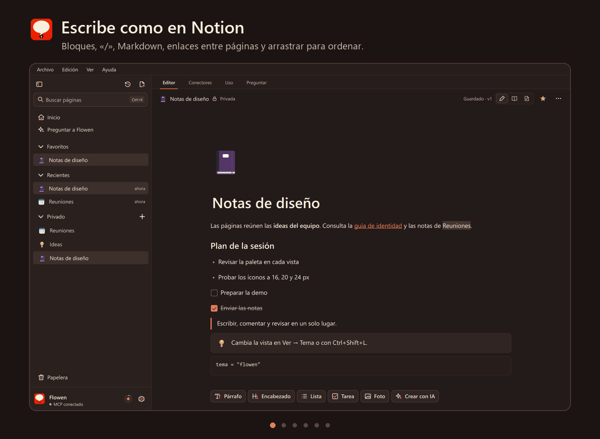

# Flowen

Flowen es un editor de notas, páginas y tareas para Windows. Guarda todo en una biblioteca local, escribe como Notion, maqueta como Word y deja que Claude o Codex trabajen sobre tus notas, en la app o a través de su servidor MCP.

Esta es su documentación: cómo se usa y cómo está hecho.

| Página | Qué encuentras |
| --- | --- |
| [Guía de uso](GUIA.md) | Todo lo que hace Flowen, sección por sección. |
| [Arquitectura](ARQUITECTURA.md) | Las partes del código (biblioteca, servidor MCP, editor e interfaz) y las reglas para ampliarlo. |
| [Desarrollo](DESARROLLO.md) | Compilar, probar, documentar, empaquetar y el contrato MCP. |
| **Clases** y **Archivos** (menú) | La API de `src/`: la biblioteca (`notes::Store`), el contrato, el editor y sus piezas. |

**Descargar:** [última versión para Windows x64](https://github.com/robertocharretonkaplun/Flowen/releases/latest) · **Código:** [github.com/robertocharretonkaplun/Flowen](https://github.com/robertocharretonkaplun/Flowen)

Flowen es una aplicación creada por [Attribute Overload](https://www.attributeoverload.com).
